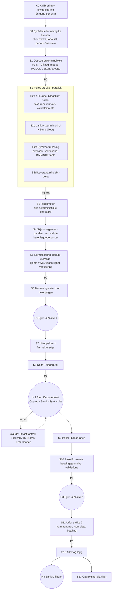

# Mva-avstemming: anbefalt arbeidsflyt

Kommandoen er «avstem mva for <klient> termin <n>». Den kan også gjelde flere navngitte klienter.

Designet bygger på tre vinkler: veggklokketid, risiko og Sjurs tid. Endepunktene står i `endepunkter.md` og kontrollene i `kontroller.md`.

## 0. Gjeldende drift: lett termin-flyt (Sjur 24.09.2026)

Den fulle flyten ble for omfattende for en enkelt mva-termin (ca. 2 mill. tokens per klient, mest fordi agenter leste alle bilagene med hele regelverket). Fra 24.09.2026 gjelder dette, og resten av dokumentet er designreferanse:

- **Per termin:**
  - `npm run mva` gjør alt maskinelt: koder, 27xx, brutto, EHF mot bokføring, dubletter og purringer, ubehandlede bilag, reskontro mot hovedbok, bank i terminen og skattekonto.
  - Claude leser bare JSON-sammendraget.
  - Budsjettet er under 30 000 tokens per klient.
- **S4 (bilagsvurdering)** er erstattet av en unntaksliste på maks 10 bilag som reglene ikke kan avgjøre maskinelt. Det er skjønnsfunn på bilagsnivå, og for registrerte klienter fradrag på risikokontoer og fra ukjente utenlandske leverandører.
  - Én agent tar lista, med `fradragsregler-kort.md`.
  - Klienter som ikke er registrert får normalt tom liste.
- **Årlig** (`--aarlig`, ved årsoppgjøret og første kjøring): kontoplanens standardkoder, reskontro med feil fortegn og gamle poster, bank hittil i år, samt § 3-26 og registreringsplikt når de er avklart. Svar lagres i klientprofilen eller `kjente-avvik.md` og gjentas ikke per termin.
- **Beslutningslista** er kort: det som må rettes og spørsmål først, én linje per punkt for resten, og detaljene i `funn.json`.

## 1. Anbefaling i korte trekk

- **Én tilstandsmaskin per klient, termin og reportType.** Den er skrevet som et Node-skript i `C:/Users/Sjur/Tripletex API` og gjenbruker `tripletex.js`, `privacy.js`, `bankavstemming.js` og `leverandor.js`. Forslag til kommando: `npm run mva -- "<klient>" --termin <n> [--fra <stadium>]`. Tilstanden lagres i `state.json`.
- **Workflow-verktøyet** brukes bare til å starte agentstadier parallelt. Menneskelige pauser er ikke ventende workflows: hvert steg som krever Sjur avslutter kjøringen, og neste kjøring tar opp tråden fra `state.json`.
- **Tripletex leses én gang per klient og termin** til et felles, maskert øyeblikksbilde. Alle kontroller leser bare filer. Ca. 80 % av kontrollene er deterministiske skript som kjører på sekunder. Agenter får bare flaggede poster, sortert etter mva-effekt, og med et fast PDF-budsjett.
- **Sjur gjør fem ting per bølge**, uavhengig av antall klienter:
  0. (valgfritt) kundeforespørsler tidlig
  1. én startkommando
  2. **beslutningsliste 1**
  3. **én ID-porten-økt**
  4. **beslutningsliste 2**
  5. BankID i banken, som kunden kan gjøre
- **Avstemmingen skjer i to faser:**
  - Fase A, før innsending: mot Tripletex' beregnede melding (vatTermAmount og `>vatTerm`-utkastet, som finnes allerede før «Opprett», jf. K0).
  - Fase B, etter innsending og synk: i avstemmingsmodulen, der ledgerData = reportedData = taxAdminData.
- **Ingen egne rapporter.** Dokumentasjonen er modulens kommentarer, kundens kildedokumenter og Tripletex' egne eksporter som vedlegg, pluss modulens PDF. Excel lages bare der modulen ikke er tilgjengelig. Det avgjøres per klient i S1, så Sjur ser det allerede i beslutningsliste 1.

**Valg der designvinklene var uenige:**

| Spørsmål | Valg | Hvorfor |
|---|---|---|
| Hvor ligger arbeidsdata? | `%LOCALAPPDATA%\silfer-mva\<år>-T<n>\<kunde-id>\` | Må overleve mellom økter (innsending kan skje dager senere). Ligger utenfor git, OneDrive og scratchpad. Mappenavnet er kunde-id, ikke firmanavn. |
| Hvem oppretter meldingen? | Sjur trykker «Opprett» i UI til `POST /vatReturns` er testet | Kallet lukker terminen. Det er ikke testet, og det kan kreve ID-porten. |
| Når skrives kommentarer i VAT-avstemmingen? | I pakke 2, etter synk, på et referenceId-format som er verifisert med «test»-metoden (K0 test 2; /validations er tom før levering). Tekstene vises allerede i pakke 1. | Avvik mot melding og Skatteetaten finnes først etter levering og synk, selv om ledgerData finnes før (K0). BALANCE-linjene skrives i pakke 1. |
| Verifiseringsagent | Ja, men bare for BLOKK-kandidater fra skjønn. Deterministiske funn trianguleres med skript. | Færre falske blokkeringer uten at tokenbruken dobles |
| Forhåndsgodkjenning med vilkår | Tillatt for kommentarer og `:complete` i pakke 1 | Sparer en runde. **Betaling krever alltid eget, eksplisitt ja** etter at beløp og KID er kjent. |
| Kundeforespørsel | Silfer-Excel fra `bankavstemming --excel` (Sjurs eksisterende liste over manglende bilag). Tripletex' `OPEN_TRANSACTIONS`-eksport er reserve. | Besluttet 24.09.2026 (§16). Kundeforespørselen er en liste over dokumentasjon som mangler, ikke en avstemmingsrapport. |
| ID-porten-økt | To runder: «Opprett» for alle klientene, deretter «Send + Synk» | Claude kontrollerer utkast N mens Sjur går til N+1 |

## 1a. Modus for klienter som ikke er mva-registrert

Sjur vil kjøre flyten også for klienter som ikke er mva-registrert, fordi reskontro, bank og bilagskontroll er nyttige der også. S1 avgjør modus med kontroll UR0 (Tripletex `vatRegistrationStatus` og Brreg må være enige).

| | Registrert (standard) | `UREGISTRERT` |
|---|---|---|
| Kontroller | Hele katalogen | A, B, C, MD1, dokumentasjonskontroller og UR1–UR7 (`kontroller.md` seksjon I) |
| Periode | Mva-terminen | Samme tomånedlige rytme som de andre klientene. UR5 summeres per kalenderkvartal, UR3 over siste 12 måneder |
| Bilagsvurdering | `bilagsvurdering.md`, alle trinn | Sjekkliste punkt 2, 4, 10, 11 og 12. Ingen fradragsvurdering, men salgsdokument, dubletter, purringer og kreditnotaer vurderes |
| Avstemmingsmodulen | VAT og BALANCE | Bare BALANCE (1500, 2400, 19xx) og klientens bankavstemming. Ingen VAT-avstemming |
| Sjurs berøringspunkter | Beslutningsliste 1, ID-porten, beslutningsliste 2, BankID | **Bare beslutningsliste 1**. Stadiene S8–S11 og S13 hoppes over |
| Skriving (etter ja) | Pakke 1 og 2 | Bare pakke 1: korreksjoner (del A), bank og BALANCE |
| Utfall som krever handling utenfor Tripletex | – | Registreringsplikt (UR3/UR4): Sjur vurderer registrering i Enhetsregisteret. Omvendt avgiftsplikt over grensen (UR5): Sjur leverer egen melding. Om Tripletex kan lage denne meldingen, er ikke kartlagt |

Vurderinger som ikke endrer seg fra termin til termin (§ 3-26, klassifisering av inntektskontoer, standardkoder i kontoplanen) lagres i klientprofilen etter Sjurs ja. De kommer bare tilbake når fakta endrer seg.

## 2. Porter og tilstander

| Port | Når | Krav | Ved brudd |
|---|---|---|---|
| **P0 Oppsett** | Etter S1 | F3.1–F3.4, F3.7 (fase FØR) og F3.8 er OK. Terminobjektet er låst. | STOPP for klienten, med melding på tre linjer |
| **P1 Datakomplett** | Etter S2 | M0: paginering fullført (til en side gir færre enn count, ikke til fullResultSize). Σ per kode fra kuben, avkortet mot null, = vatTermAmount og `>vatTerm`-linjene, og = Σ overview.ledgerData når VAT-avstemmingen finnes. Saldo på avgiftskontoene uten 2740 stemmer. Stoppflaggene i validateCreate registreres. | STOPP for alle konklusjoner. Datasettet hentes på nytt én gang. |
| **P2 Port** | Etter S5 | **GRØNN**: ingen BLOKK. **GUL**: BLOKK finnes, men Sjur kan avgjøre (rett, godta, neste termin eller korrigert melding). **RØD-kunde**: kunden må levere noe. **RØD-data**: STOPP. | RØD-kunde: tilstand VENTER_KUNDE. Bare handlingsliste og kundeutkast, ingen skriving. |
| **P3 Klar til opprettelse** | Etter S8 | Ingen BLOKK uten beslutning. M0 grønn. validateCreate: incompleteVouchers = 0 og ingen hjelpekonto. Fingerprint uendret siden godkjenning, bortsett fra våre egne korreksjoner. | Delta-runde. Unntaksliste for bare den klienten. |
| **P4 Levert** | Etter S10 | RECEIPT_RECEIVED eller MANUAL_DELIVERY. Oppgjørsbilag = melding (T5). IN11: Skatteetatens beløp = meldingen. T12: tre-veis likhet (taxAdmin ≠ null). Fingerprint i fasen ETTER_INNSENDING. | FAILED: Sjur trykker «Send på nytt». taxAdmin null: Sjur synker. |
| **P5 Fullført** | Etter S11 | VAT COMPLETED, eller CONTROLLED når requiresControl er satt. BALANCE COMPLETED når alle linjene er dokumentert. Betalingen er opprettet og venter på signering. | Blir stående med merknad. BALANCE kan stå åpen uten at mva-flyten stopper. |

Tilstander i `state.json`:

```
OPPSETT_OK → DATA_OK → KONTROLLERT → VERIFISERT → VENTER_SJUR_P1 | VENTER_KUNDE → P1_UTFØRT →
KLAR_TIL_OPPRETTELSE → OPPRETTET → LEVERT → VENTER_SYNK → VENTER_SJUR_P2 → P2_UTFØRT → ARKIVERT → OPPFØLGING
```

## 3. Avhengighetsgraf



**Parallelt:**
- S2a–d innbyrdes.
- Områdene i S3 og agentene i S4 innbyrdes.
- Klienter innbyrdes fram til H1.
- Etter H1 går hver klient videre i sitt eget tempo.

**Sekvensielt:**
- S1 før S2, fordi terminobjektet trengs.
- M0 før resten av S3.
- S7 i fast rekkefølge.
- S10 først etter kvittering.

## 4. Stadier

| Stadium | Kjører | Inn → ut | Tid |
|---|---|---|---|
| **K0 Kalibrering** | Skript (lesende) + Sjur (en «test»-kommentar i UI, bekrefter prøveskrivinger) | De 16 testene i `endepunkter.md` → `kalibrering.md`/`kalibrering.json` (BRUK/FALLBACK/MANUELT per funksjon) og oppdatert `docs/avstemmingsmodul.md`. **Lesedelen er kjørt 2026-09-24 (se `kalibrering.md`). Test 2 (Sjurs «test»-kommentar), 15 (prøveskrivinger) og 16 (ID-porten på tvers) gjenstår.** Deretter **skyggekjøring** på allerede fullførte terminer (f.eks. T1–T3 for en klient Sjur velger). En BLOKK på en godkjent termin er en kandidat til falsk positiv som må justeres før drift. Mål: under 3 BLOKK og under 15 FORKLAR per normal termin. | 30–45 min maskin. Sjur ca. 20 min én gang. |
| **S0 Byrå-tavle** | Skript (byrå) | Navngitte klienter → `batch.json`: frist (dueDate/customDueDate), status, tellere, modus, reportTyper. Sortert etter frist. Levert eller NOT_APPLICABLE tas ut og nevnes. | 5–15 s totalt |
| **S1 Oppsett** | Skript | Profil, kjente avvik, vatSettings, vatTermSizeSettings, postingRules, overview, status/list, Brreg og id-kart → `termin.json` {reportType[], term, start, sluttEksklusiv, dueDate, fase} og `modus.json`. Flere reportTyper gir flere løp. | 2–10 s per klient |
| **S2a API-uttrekk** | Skript (samtidighet 4 per klient, maks ca. 16 per byråtoken) | → `data/*.json.gz` + `manifest.json` (endepunkt, parametre, fields, tidspunkt, radantall, sha256, probe). Historisk kube hentes bare første gang i året, og ellers når ET1 slår ut. | 30–90 s (første gang med normer 2–4 min) |
| **S2b Bank** | Skript (`bankavstemming` CLI + bank-tillegg: state for åpne måneder, approvable, dekning av kontoutskrifter, drafts, interim) | → `bank/status.json`, `data.json`, `bank-mva.json`. Kjøres tidligst 2–3 bankdager etter T_slutt, ellers merkes resultatet «foreløpig» og porten blir GUL. Med mer enn ca. 5 klienter kjøres `--alle` én gang. | 5–15 s per klient |
| **S2c Modul-lesing** | Skript (byrå) | → `modul.json`: VAT-id og de **to** månedlige BALANCE-id-ene hvis de finnes (`reconciliations?customerId&year&term&type`, kontrollert lokalt), overview for T (bare når avstemmingen finnes) og leverte terminer, validations, eksisterende kommentarer og vedlegg, BALANCE table for begge månedene, requiresControl | 3–10 s |
| **S2d Leverandørindeks** | Skript | Nye leverandør-id-er → indeksen (felles, bare firma). Liste over ukjente leverandører. | 2–20 s |
| **S3 Regelmotor** | Skript (én prosess, bare filer) | → `funn.json` (felles format), `sjekkliste.json` (status per kontroll og punkt 1–17, også «ikke kjørt – grunn»), `overlevering.json` | 5–30 s |
| **S4 Skjønn** | Agent per område (parallelt, tak ca. 8). Leverandøragenten kjører én gang på tvers av klientene. | Skiver på maks ca. 40 poster med ferdig kontekst → `vurdering.json` (skjema: nøkkel, konklusjon OK/RETT/FORKLAR/KORRIGERT_MELDING/SPØR_SJUR, begrunnelse på én setning med hjemmel, forslag, kommentarutkast på maks 1024 tegn). Tidsavbrudd gir SPØR_SJUR. | 2–8 min per klient med funn, 0 uten |
| **S5 Normalisering og verifisering** | Skript + verifiseringsagent i egen kontekst | Dedup og eierskap, kjente-avvik-filter, vesentlighet og foreslått alvor. BLOKK-kandidater trianguleres (to uavhengige kilder). Skjønnsfunn prøves avkreftet av en agent med katalogen over kjente falske positiver. Resultat BEKREFTET/SANNSYNLIG/AVVIST → `verifisert.json` | 3–10 min |
| **S6 Beslutningsliste 1** | Skript (maler) + én tekstagent for bølgen | → `port.json`, `skriveliste.json` (nummererte handlinger med eksakt kall, body, forventet tilstand før kallet og idempotensnøkkel), `beslutning-1.md` og kort versjon i chat | 2–5 min |
| **H1** | Sjur | Svar som «ja 1–9, nei 4, 6 → neste termin, ja til alle grønne» | 10–30 min for 10–15 klienter |
| **S7 Pakke 1** | Skript | Utfører i fast rekkefølge (avsnitt 8). Logger `utført.jsonl` med id-ene som kommer tilbake. | 1–5 min per klient |
| **S8 Delta og fingerprint** | Skript (agent bare for nye nøkler) | Billige prober: vatTermAmount, validateCreate, inboxCount, nonPosted changedSince og saldobalanse. Bare endrede datasett hentes på nytt, og bare berørte kontroller kjøres. → `fingerprint.json`, P3. | 15–45 s |
| **H2 ID-porten-økt** | Sjur i UI, polling i bakgrunnen | Se avsnitt 7 | 3–5 min per klient |
| **S9 Poller** | Lokalt Node-skript (`run_in_background`), bare lesing, maks 8 t | /vatReturns/status per klient hvert 30. sekund (fra byrået via `/vat/reconciliation/{id}/status` når mange klienter skal følges). Starter S10 ved kvittering og gir beskjed når Sjur trykker «Opprett» (voucherNumber > 0). | – |
| **S10 Fase B** | Skript | T12, ET1 og F0.3 (fase ETTER), IN11, IN13–IN16, validations → referenceId, S19 og tilgode → `beslutning-2.md` | 30–60 s per klient |
| **H3** | Sjur | Ett «ja». Betaling er egen linje med beløp, KID, dato og fra-konto. | 2–5 min |
| **S11 Pakke 2** | Skript | Se avsnitt 8 | 1–3 min per klient |
| **S12 Arkiv** | Skript (lokalt) | PDF, XML og kvittering lagres i `<klient>/<år>/Mva/`. `logg.md` får én linje. Godkjente linjer i kjente-avvik.md og klientprofil. `mva-normer.json` oppdateres. Arbeidsmappa slettes (+7 d). | < 1 min |
| **S13 Oppfølging** | Planlagt skript (opprettes etter Sjurs ja én gang), bare lesing | IN18 ved forfall − 2 virkedager. IN20 og T10/SK1 etter forfall. ET1 i neste termin. | Sekunder |

## 5. Datastrategi

**Hentes én gang per klient og termin, og deles:**
- terminobjekt
- kontoplan og postingRules
- vatType-kart med spesifikasjonskoder og relative koder
- saldobalanse (T, T−1, T i fjor, hittil i år)
- **lett posteringskube** [1.1. i fjor, T_slutt+15 d). Bare id-er og tall, ingen nestede bilagsfelt.
- **bilagskart** (én rad per bilag)
- kunde- og leverandørkart (land, orgnr, isPrivateIndividual, isFactoring). Navn bare for firma.
- fakturaer T til T+45 d
- leverandørfakturaer (gamle register + ny flyt eller fallback)
- innboks, nonPosted, validateCreate, vatTermAmount
- åpne poster per D
- status/list for i år og i fjor
- asset
- accountingPeriod
- bankresultat
- modul-lesing
- leverandørvurderinger

Mva-effekten beregnes **én gang** i kuben: `amountGross − amount` på kodede linjer, og grunnlag × sats ved snudd avregning. Alle områdene bruker samme tall.

**Byrånivå, én gang per kjøring:** tellerne fra `/clientTasks/*` og `/todoList/vatReturnsSection` filtrert på de navngitte klientene. Merknadskatalogen (/vatReturns/comment) caches per dag.

**Varig cache, uten persondata:**
- `klientprofil.md`, `kjente-avvik.md`, `kapitalvarer.md` og `mva-normer.json` (aggregerte kodepar) i klientmappa
- `data/leverandorer.json` (felles, bare firma, Brreg-TTL 30 d, «vurdert av Sjur» overstyrer)
- `kalibrering.json`

**Lagring og GDPR:**
- Arbeidsdata i `%LOCALAPPDATA%\silfer-mva\...`. Aldri i repo, OneDrive eller klientmappa.
- Slettes 7 dager etter P5. Ved rød port eller avbrudd slettes den etter maks 45 dager (opprydding).
- All henting går gjennom én `hent()` som **krever** `fields=` og nekter personfelt (employee, createdBy, uploadedBy, lastUpdatedBy, reconciledBy, controlledBy, bankkonto, email og lignende).
- `/travelExpense` gir bare tellinger og summer. `/timesheet` brukes ikke; prosjektreserven erstatter den.
- Banktekster, EHF-innhold og PDF-er ligger bare i arbeidsmappa eller i minnet. De kjøres gjennom `redact()` før de går til en agent, chat eller fil.
- Hovedsesjonen ser bare `port.json` og teksten i beslutningslistene, aldri datasettene.
- Beslutningslistene, modulkommentarene og logg.md har ingen personnavn. Privatkunder vises som «privatkunde n», ansatte som «ansatt n».

**Teknisk forutsetning i tripletex.js:**
- én prosess med felles tokencache (refresh-token kan rotere)
- 429/5xx-backoff
- global samtidighetsgrense
- byråklient med `authorization(0, konto)` i egen modul

## 6. Skript, agent og Sjur

- **Skript:**
  - all henting, datoklassifisering og termintilhørighet
  - alle regelkontroller (alt merket S i katalogen)
  - M0
  - portene og fingerprint
  - pakkene bygges fra maler
  - all skriving etter ja, med idempotens
  - polling, arkiv og logg
  - Excel-fallback (Python `stil.py` fra lonnsavstemming-a07 leser `funn.json`)
  - én kilde per kontroll. Python-kontrollene i `tools/kontroller` enten rettes eller porteres, ikke begge.
- **Agent** (bare `trenger_skjonn=ja`, strukturert JSON inn og ut, ingen API-tilgang utover PDF/EHF innenfor budsjett, **aldri skrivende kall**):
  - alt merket A i katalogen
  - leverandøragenten, én gang per ukjent leverandør på tvers av klienter
  - verifiseringsagenten (prøv å avkrefte)
  - tekstagenten (beslutningslister, kommentarer, merknader, kundetekster)
  - lettere modell for klassifisering av leverandører og normer, standardmodell for vurdering av tap, kapitalvarer og ET
- **Sjur:**
  - navngi klienter
  - beslutte (H1, H3)
  - ID-porten: Opprett til kallet er testet, Send, Synkroniser, Kontroller ved fire øyne, lås periode
  - BankID
  - Tolletaten-fil (MI2)
  - skattekontoutskrift ved avvik eller i T6
  - kontonummer for tilbakebetaling hos Skatteetaten
  - eksportdokumentasjon (EX3)
  - beslutning om korrigert melding
  - lovtolkning første gang (lagres som regel)

**Claude gjør aldri:**
- :send, :resend
- syncWithTaxAdmin
- betaling :approve
- :control
- SendEmail-eksport
- `updateBalance=true` utenfor IN15
- `force=true`
- skriving mot en klient som ikke er navngitt
- skriving uten ja

## 7. Sjurs berøringspunkter per bølge

| # | Når | Hva | Tid (ca. 15 klienter) |
|---|---|---|---|
| 0 | Valgfritt, 3–5 virkedager etter T_slutt | «kjør mva-forberedelse T<n> for <klienter>». S0–S2 + F1/F2/BK3/BK7 gir kundeforespørsler (attestering, manglende bilag, oppgjørsrapporter, kontoutskrifter) og forespørsel om Tolletaten-fil for importører. Sjur sender, eller godkjenner at det lages utkast. **Kunden får tid, og hovedkjøringen finner færre røde poster.** | 5–10 min |
| 1 | Start (ca. 15–20 d før forfall) | Én kommando. Alt fram til P2 er lesing, så det trengs ingen bekreftelse. Kan kjøres om natten. | < 1 min |
| 2 | Beslutningsliste 1 (H1) | Én liste for bølgen: grønne («bare ja»), gule («les»), røde (kunde / deg). Handlinger: **A** korreksjoner, **B** modul og bank før innsending, **M** merknader (betinget), **K** kundeutkast, **P** profil og kjente avvik, **?** spørsmål. Vilkårsgodkjenning for kommentarer og :complete er mulig. | 10–30 min |
| 3 | ID-porten-økt (H2), helst ≥ 5 virkedager før forfall | **K0 test 16 (Sjur 24.09.2026): innloggingen varer 10 min og gjelder alle klientene i byråkontoen.** Derfor gjøres alt som ikke krever ID-porten, før innlogging. **Runde 1 (uten ID-porten):** «Opprett» for alle. Claude kontrollerer utkastet og setter godkjente merknader på ca. 30–60 s per klient mens Sjur går videre. Claude lager så én sjekkliste i fristrekkefølge med direkte lenker. **Runde 2 (i 10-minuttersvinduer):** per klient «Send», så «Synkroniser med Skatteetaten». Med ca. 1 min per klient rekker Sjur 6–8 klienter per innlogging. Når økten går ut, logger han inn på nytt og fortsetter der sjekklisten viser. Claude følger med på status (S9) og krysser av. «Kontroller» og «Lås periode» krever ikke ID-porten og tas etterpå. Sjur trenger ikke skrive «sendt». | 30–45 min |
| 4 | Beslutningsliste 2 (H3) | Én tabell: betalinger (klient, beløp, KID, forfall, fra-konto, vei; **eksplisitt ja per betaling eller «ja alle betalinger» etter å ha sett tabellen**), kommentarer og :complete (bare unntak ved vilkårsgodkjenning), kundebeskjeder | 2–5 min |
| 5 | BankID | Sjur eller den rollen hos kunden som har betalingsrett (profil: `betaling_godkjennes_av`, rolle og ikke navn) | 1–2 min per bank |

**Sum:** ca. 1–1,5 time aktiv tid for 15 klienter, to «ja», 2–3 ID-porten-innlogginger (10 min hver) og kundenes godkjenning av betalingene. For én grønn klient: ca. 6–10 min. Med funn: 15–25 min.

**Unntak:**
- Rød-kunde gir en ny kort liste når kunden har levert («fortsett <klient>» kjører delta fra S2).
- Første gang per klient: nye profilfelt (Claude foreslår, Sjur sier ja/nei).
- Korrigert melding for tidligere termin: egen handling i ID-porten. :unlock, kommentar og :complete på den gamle avstemmingen legges i pakke 2.
- FAILED: «Send på nytt».

## 8. Skriverekkefølge

**Pakke 1** (før innsending, etter H1). Fast rekkefølge, fordi feil rekkefølge gir 422 og låste perioder:

1. **Del A regnskapskorrigeringer:** kodebytter, reverseringer og nye bilag, flytting av bilagsdato (voucherDate), utligninger, tapsføring. **Mva-korreksjoner på bilag med banklinje gjøres før bankmånedene lukkes.**
2. Godta Tripletex' bankforslag (grupper fra BK17).
3. Les state på nytt og lukk bankmåneder med differanse 0 (BK1). Metoden velges i K0.
4. Manuelle avstemminger eller saldo for kontoer uten bankfeed (BK7).
5. `context`-POST for VAT og for BALANCE **per måned** (BALANCE er månedlig: to per termin) bare der avstemmingen mangler. Idempotensen testes i K0 test 15.
6. **BALANCE-linjer** (PUT `table/{accountId}` eller `table/list`, body = linjen fra GET med reconciledBy/controlledBy = null), for begge månedene i terminen:
   - documentedBalance og status for 1500, 2400, 19xx, oppgjørskontoer, interim, skattetrekk og kapitalvarekonti. 19xx blir ikke auto-avstemt når banken lukkes, så status settes til RECONCILED når documentedBalance ≠ null og difference = 0.
   - vedlegg: kundens kildedokumenter og Tripletex' egne eksporter
   - kommentarer ved differanse
   - alltid GET comments og attachments før POST
7. Eventuelt `POST /vatReturns` og `:modifyComment` når de er testet og godkjent. Ellers skjer dette i H2.

Etter pakke 1 følger S8 (delta og fingerprint) og P3.

**H2**: Opprett, utkastkontroll og merknader, Send, Synk, (Kontroller), **lås periode**. Perioden låses etter at bankmånedene er lukket, ellers blir bankavstemmingen skrivebeskyttet.

**Pakke 2** (etter levering og synk, H3):

1. IN14 dobbeltbetalingskontroll rett før.
2. **Betaling (avsnitt 10):** opprett betalingen i Tripletex slik at den legger seg til godkjenning hos kunden: `POST /bank/paymentWidget?scenario=VAT_RETURNS_2022&scenarioId=<vatReturns2022Id>`. Beløp, KID og forfall kommer fra `paymentInfo`. Ta øyeblikksbilde av betalingslisten før og etter kallet (IN17). Claude godkjenner aldri (`/bank/payment/:approve`).
3. **Kommentarer:** referenceId = linjens `vatTypeId` (Tripletex-id, ikke kodenummeret). Dette er verifisert i K0 test 2 med Sjurs «test»-kommentarer på kode 3, 1 og 86. Kode 86 har to linjer med samme vatTypeId, og én kommentar vises på begge. Skriv derfor én felles forklaring for snudd avregning. Bruk `comments/list` for flere kommentarer. Vedlegg: skattekontoutskrift, tolldeklarasjoner, dokumentasjon.
4. VAT `:complete`. Ved 422: kommenter de manglende referenceId-ene én gang til hvis teksten allerede er godkjent, ellers tilbake til Sjur. Er requiresControl satt, venter flyten på CONTROLLED. Sjur eller en kollega kontrollerer.
5. BALANCE `:complete` **per måned** (to per termin) når alle linjene har status. 2740 blir autoReconciled i begge månedene først etter VAT :complete. 2600/2610/2770/2771 blir auto når lønnsavstemmingen er fullført. 2700–2739 blir aldri auto og må settes (RECONCILED eller IGNORED). Kan stå åpen med en merknad.
6. Kundebeskjed som tekst. E-postutkast lages bare etter eget ja.

## 9. To-fase-avstemming

- **Fase A (før innsending):**
  - Uavhengig summering fra kuben (grunnlag og mva per vatType, avkortet mot null per kode) mot `vatTermAmount` og utkastets linjer (`/vatReturns/>vatTerm`, uten fields). K0 viste at utkastet finnes også før Opprett (id=0).
  - `overview.ledgerData` er ekstra kontroll før innsending (K0: fylt ut, og Σ = vatTermAmount), men bare når VAT-avstemmingen finnes. `difference` brukes aldri før levering.
  - Linje med fortegn motsatt av expectedSign gir T16.
  - 27xx og 2740 kontrolleres med faktiske dueDate (T3, T4, T9, T11).
  - Omsetning mot grunnlag (T7), sats (T6), merknadsbehov (N1–N7) og validering (T14).
  - Avvik rettes før innsending (del A). Utkast som avviker ≥1 kr per linje fra P3-tallene: **Sjur sender ikke.**
- **Fase B (etter innsending og synk):**
  - `overview`: ledgerData = reportedData = taxAdminData (T12). Begge avvikene regnes selv.
  - `/validations` kan gi referenceId-er som må forklares (uavklart for mva). Kommentarene skrives bare på verifisert referenceId, og deretter `:complete`.
  - PDF-rapporten fra modulen er dokumentasjonen.
  - Tidligere terminer: ET1 i neste termins S3.

## 10. Betaling

- **Grunnlag:** `paymentInfo` (KID, Skatteetatens konto, beløp, forfall) er kilden, kontrollert mot kravets KID og beløp i claimsAndPayments når kravet finnes (IN13). KID er unik per termin (K0), så det finnes ikke noe profilfelt `mva_kid`, og widgeten gir 403. Beløp = altinnPaymentAmount = totalAmountVatToPay = paymentInfo.amount (IN11).
- **Nullmelding eller tilgode** (A ≤ 0): ingen betaling. Kontroller i stedet at fordringen er ført og at kontonummeret er bekreftet (IN19), og følg opp med IN20.
- **Hva «opprette betaling» betyr (Sjur 24.09.2026):** betalingen opprettes i Tripletex og legger seg i godkjenningsflyten, der den venter på at kunden godkjenner den. Om klienten har AutoPay eller ZTL, spiller ingen rolle for flyten, fordi Tripletex håndterer det etter godkjenning. Kallet er `POST /bank/paymentWidget` (scenario `VAT_RETURNS_2022`, eller `VAT_RETURNS_2022_PRIMARY_INDUSTRY`; scenarioId = meldingens id). Body er `SimplePaymentWidget`: `selectedPaymentType` (fra-konto/betalingstype fra GET-widgeten), `date` = forfall, `amount`, `kid` (låst for mva) og `bankAccount`. Betalingen får status NEW eller «til godkjenning». Godkjenning (`/bank/payment/:approve`) og signering gjøres av kunden. **Claude godkjenner aldri.**
- **Blokkering (K0):** GET-widgeten og `/bank/payment` gir 403 code 9000 for API-brukeren hos kalibreringsklienten. Tokenet har ingen scope-claims, så årsaken er trolig rettighetene til brukeren hos klienten, dvs. tilgang til betalinger og utbetalinger. Sjur sjekker brukertilgangen. Til det er løst, lager flyten kundetekst med beløp, KID, konto og forfall i stedet (reserve). Første ekte opprettelse er prøveskrivingen i K0 test 15, på en levert termin og etter Sjurs ja.
- Kundebeskjed når betalingen er opprettet: «Mva-betalingen for termin n ligger til godkjenning i Tripletex, med forfall dd.mm. Ikke betal den separat.» SK1 i neste termin godtar NOT_PAID når betalingen finnes i bank.
- **Dato:** forfall (Skatteetatens dueDate fra overview eller paymentInfo, som flyttes ved helg, jf. K0). Beregnes ikke selv. Er det for sent, varsles risiko for renter, og første mulige bankdag foreslås.
- **Dekning** (IN15): varsles sammen med kundebeskjeden.
- **Oppfølging:** IN18 ved forfall − 2 virkedager, IN17/T10/SK1 etter forfall.

## 11. Etterarbeid

- **Arkiv** i `<klient>/<år>/Mva/`:
  - `Mva-avstemming <Klient> termin <n> <år>.pdf` (modulens document via `/document/{id}/content` i byråkontekst)
  - XML (`/vatReturns/{id}/xml`)
  - kvittering (receiptId, antatt å være dokument-id). Mangler den, noteres det i logg.md.
- **logg.md**, én linje: dato, levert-tid, beløp, KID ok, forfall, betalingsvei og -status, antall funn (rettet, akseptert, kjent, åpen), låst ja/nei. Ingen personnavn.
- **kjente-avvik.md:** bare godkjente linjer, med `gyldig_til` innen 12 mnd.
- **klientprofil.md:** godkjente profilfelt.
- **kapitalvarer.md:** oppdateres etter KV1/KV3/KV4/KV5.
- `mva-normer.json` oppdateres inkrementelt.
- Arbeidsmappa slettes.

## 12. Flere klienter samtidig

- «Alle» er ikke navngiving. Sjur navngir klienter, eller en navngitt gruppe han selv har definert, f.eks. «tomånedlig med frist 12.10». Listen over klienter som blir med vises før kjøring. Byråkall filtreres med `clientCompanyIds`.
- Byrånivået hentes én gang per byrå-token (silfer og unikum kjøres parallelt). Klientpool med **maks 4 klienter i S1–S3 per token**, alle i én Node-prosess med felles tokencache og backoff. Bank-CLI med `--alle` når det er mer enn ca. 5 klienter. Leverandørindeksen oppdateres samlet før S4e.
- Agentskiver fra alle klientene kjøres i `parallel()` med tak på ca. 8. Klienter uten flagg bruker ingen agent.
- Beslutningsliste 1 og 2 er én fil per bølge med én blokk per klient. Hver klient har egen `skriveliste.json` og hash, så et «nei» på én påvirker ikke de andre.
- ID-porten-økten tas i rekkefølge etter frist. En klient som stopper (delta, fingerprint, FAILED) holder aldri igjen de andre.
- **Estimat for 20 klienter:** maskintid fram til liste 1 ca. 20–35 min. Sjur: liste 1 30–60 min, ID-porten ca. 60 min, liste 2 10–15 min. Arbeidet kan spres over flere dager, fordi tilstanden ligger per klient.
- Primærnæring, årstermin og månedstermin plasseres i den bølgen der deres egen `dueDate` faller.

## 13. Ny kjøring etter rettelser

- **Datasettnivå:** hver fil har en probe (vatTermAmount og saldo T, nonPosted changedSince, inboxCount, siste bank-postedDate, modulstatus). Uendret probe betyr gjenbruk. Endret probe betyr at bare det datasettet hentes på nytt. 403 eller pilotbegrensning gir FALLBACK, og det prøves ikke igjen.
- **Kontrollnivå:** hver kontroll oppgir hvilke datasett den bruker, og kjøres bare når hash-en på ett av dem er endret.
- **Agentnivå:** vurderinger caches per (nøkkel, bilagets changes-tidspunkt, profilhash). Bare nye eller endrede funn sendes til agent.
- **Beslutninger:** tidligere «ja/nei/neste termin» gjelder fortsatt når nøkkelen er uendret. Ny liste viser bare diff.
- **Skriving:** `utført.jsonl` per handling. Ved gjenopptak leses objektets faktiske tilstand først (GET comments/attachments, S14 for betaling, GET status for :complete). **Skriving gjentas aldri blindt.**
- **Feil:** 3 forsøk med backoff per lesekall. Et datasett som feiler gir «ikke kjørt – grunn» (aldri grønt) og minst GUL port.
- **Etter Opprett:** nye korreksjoner i T er låst. De hører til neste termin eller korrigert melding, besluttet av ET-eieren.
- **Mer enn 7 dager gammel, eller mer enn 20 % av bilagene endret:** full ny kjøring.

## 14. Avstemmingsmodulen og Excel-fallback

- **VAT_GENERAL_INDUSTRY / VAT_PRIMARY_INDUSTRY:** funn med mva-effekt som står igjen etter retting får én kort kommentar per berørt kodelinje etter synk. Stil: én setning med årsaken, uten utregning og uten navn, f.eks. «Fire bilag rettet fra kode 1 til 86 før innsending.» Vedlegg er kundens kildedokumenter (tolldeklarasjoner, tapsdokumentasjon) og skattekontoutsnitt. Deretter `:complete`, og modulens PDF er dokumentasjonen.
- **BALANCE** (forutsatt at Sjur sier ja, se åpent spørsmål 4): 1500, 2400, 19xx, oppgjørskontoer, interim, skattetrekk, 2740 og kapitalvarekonti. documentedBalance, status (RECONCILED, eller IGNORED for statiske og inaktive kontoer), vedlegg (Tripletex' bankavstemmings-PDF, kundens kontoutskrift eller oppgjørsrapport, kapitalvareoversikt) og kommentar ved differanse. Perioden hentes fra `periodsOverview(type=BALANCE)`. K0 viste at perioden er **månedlig** (ANNUAL_BALANCE filtreres bort), så begge månedene i mva-terminen dokumenteres, hver med D = endDate.
- **Klientens egen bankavstemming:** måneder lukkes der (pakke 1).
- **Modulen har ikke:** reskontro per motpart, aldersfordeling, bilagsliste per mva-linje, kapitalvareregister, skattekonto eller sjekkliste 1–17. Dette dekkes av kommentarer og vedlegg, og sjekklisten står i logg.md.
- **Excel-fallback** (F3.1 gir EXCEL eller DELVIS når canAccessVat/canAccessBalance=false, verifyModule=false, detaljkall gir 403, eller referenceId ikke kan verifiseres): **én** arbeidsbok per klient og termin, `<klient>/<år>/Mva/Mva-avstemming <Klient> termin <n> <år>.xlsx`, i Silfer-stil. Ark:
  - Sammendrag
  - Per kode (hovedbok, melding, Skatteetaten, differanse, kommentar)
  - Forutsetninger
  - Reskontro
  - Bank
  - Oppgjørskontoer
  - Innførsel
  - Leverandører
  - 2740/Skattekonto
  - Merknader
  - Funn (kontroll, bilag, konto, kode, grunnlag, mva-effekt, kommentar, status)

  Tripletex' egne eksporter arkiveres først. Excel-filen har ingen personopplysninger. Blir modulen tilgjengelig senere, legges filen ved der.

## 14a. Dokumentasjonspakke i avstemmingsmodulen (Sjur 24.09.2026)

Sjur vil ha **så mye dokumentasjon som mulig lagret som vedlegg og kommentarer i avstemmingen**. Flyten lager en plan (`dokumentasjon.json`, og tabellen nederst i beslutningsliste 1). Opplastingen skjer etter ja, med `POST /accountingOffice/reconciliations/{id}/attachments?referenceId=<ref>` (multipart, felt `file`, testet med PDF 23.09.2026). Les alltid GET attachments/comments før og etter.

| Avstemming | Linje | Dokument | Kilde | Status 24.09.2026 |
|---|---|---|---|---|
| VAT termin n | hele terminen | Kvittering for innsendt mva-melding | `vatReturns.receiptId` → `/document/{id}/content` | **403 for API-brukeren**. Sjur sjekker rettighetene. |
| VAT termin n | hele terminen | Mva-meldingen (XML) | `/vatReturns/{id}/xml` | **403** |
| VAT termin n | kodelinjer (vatTypeId) | Forklaring på avvik, tolldeklarasjoner, eksportdokumentasjon | kommentarer + klientmappa | referenceId = vatTypeId (verifisert) |
| BALANCE, siste måned i terminen | 2740 | Kvittering for terminen | som over | 403 |
| **ANNUAL_BALANCE år** | **2740** | **Kvitteringer for alle årets mva-meldinger** (Sjurs krav) | som over, alle terminer | 403 |
| BALANCE hver måned | 19xx | Tripletex' bankavstemmingsrapport og kontoutskrift | `PUT /bank/reconciliation/internal/export/pdf` (bare eksport, men PUT-verb: testes etter ja) + klientmappa | må testes |
| BALANCE hver måned | 1500 / 2400 | Åpne poster per D | openPost + kunde- og leverandørkart (firmanavn, privatkunde n, ENK skjult) | lages av flyten (PDF-generator mangler) |
| BALANCE hver måned | 2500 / 2600 / 2770 | Skattekonto: krav og betalinger | `/claimsAndPayments` | lages av flyten |
| BALANCE | kontoer med funn | Kommentar (én setning med årsak, Sjurs stil) | funn etter Sjurs beslutning | referenceId for BALANCE ikke verifisert (test 2 fant ingen «test»-kommentar) |

Andre kilder som kan brukes: `/ledger/balanceSheet/pdf`, `/ledger/internal/general/pdf` (hovedbok, f.eks. 27xx), `/ledger/balanceReport/pdf` og `PUT /accountingOffice/reconciliations/documentationFolderId` (dokumentasjonsmappe per klient).

**Ikke bruk** `POST /vatReturns/{id}/attachment` til dokumentasjon. Det legger vedlegget på selve mva-meldingen, som sendes til Skatteetaten.

## 15. Risiko

| Risiko | Tiltak |
|---|---|
| Sentrale skrivekall er ikke testet (POST /vatReturns, :modifyComment, BALANCE PUT, context-POST, banklukking) og referenceId for mva er ikke verifisert. De lesende kallene er kalibrert i K0 (`kalibrering.md`). | K0 test 2 og 15 + `kalibrering.json`. Hver kontroll har en fallback. Til et kall er testet, gjør Sjur steget i UI. |
| Opprettelse lukker terminen | Hard P3 med fingerprint. Opprett gjøres av Sjur. Utkastkontroll før Send. |
| Stille feil i eksisterende kode (dateTo, enum, ledgerType, fields=*) | Rettes eller porteres før gjenbruk (egen oppgave). M0 fanger uttrekksfeil. Skyggekjøring gir regresjonstest. |
| Falske positiver drukner de ekte funnene | Rettelsene fra verifiseringen er tatt inn i reglene. Én vesentlighet. Kjente avvik filtreres før agent. Verifiseringsagent. Skyggekjøring. |
| Stale data mellom ja og utførelse | Fingerprint før skriving, før Opprett og før :complete |
| Dobbeltbetaling eller feil beløp | IN11 + IN13 + IN14 rett før POST. Øyeblikksbilde før og etter. Aldri POSTING_RULE. Claude godkjenner aldri. |
| Feil rekkefølge mellom bank og periode (422, skrivebeskyttet) | Fast rekkefølge i utfører-skriptet |
| Kommentar på feil referenceId (201, men usynlig) | Mva: referenceId = vatTypeId, verifisert i K0 test 2. BALANCE: ikke verifisert ennå. Les alltid comments etter POST. DELETE for å rydde. |
| GDPR-lekkasje via standardfelt og banktekster | Hviteliste for fields i `hent()`, `redact()`, arbeidsmappe utenfor sync, automatisk sletting |
| Struping og tokenrotasjon ved parallellkjøring | Én prosess, felles tokencache, backoff, samtidighetsgrenser |
| Kjente avvik skjuler for mye | Kan bare dempe BLOKK med akseptert_av og gyldig_til. Vises alltid som antall. Endret beløp gir ny nøkkel. |
| Agenten tar feil om regelverket | Hjemmel er obligatorisk, verifiseringsagent sjekker. Lovtolkning bekreftes av Sjur og lagres. |
| ID-porten-økten varer bare 10 min (K0 test 16, gjelder på tvers av klienter) | Alt som ikke krever ID-porten gjøres før innlogging. Sjekkliste i fristrekkefølge med lenker. Ny innlogging når økten går ut. |
| Bankdata er ufullstendige ved tidlig kjøring | «Foreløpig» og GUL port. Kjør 2–3 bankdager etter T_slutt. |
| BALANCE-periode ≠ mva-termin (K0: BALANCE er månedlig) | To BALANCE-avstemminger per termin. D og periode hentes fra periodsOverview(type=BALANCE), og `term` brukes alltid sammen med `type`. |
| Firøyneprinsippet brytes | Claude kjører aldri :control. S12 venter på CONTROLLED. |

## 16. Åpne spørsmål til Sjur

**Besluttet 24.09.2026** (erstatter tilsvarende spørsmål under):
- **Kalibrering (1):** Testklienten er en mva-registrert klient med T1–T3 2026 ferdig avstemt i modulen, og den brukes som fasit. Prøveskrivinger krever fortsatt ja hver gang.
- **Feil i levert termin (5):** Rettes i **inneværende termin**, ikke med korrigert melding. Flyten foreslår korreksjonsbilag i åpen termin og merknad på berørt kode (ET-kontrollene), og nevner i beslutningslisten når beløpet er vesentlig. Hovedregelen i regelverket er at feil rettes i terminen de gjelder. Det er Sjurs valg, og korrigert melding kan fortsatt velges per sak.
- **Periodelås (7):** Ja, for alle klienter. Flyten minner om låsing etter innsending, og etter at bankmånedene er lukket. Sjur låser selv i UI.
- **Betaling (6, bekreftelsesform):** Ett «ja» etter at betalingstabellen er vist (klient, beløp, KID, forfall, fra-konto). Enkeltrader kan tas ut. Betalingsvei og godkjenner per klient står i profilen.
- **Standardvalg uten innvendinger:**
  - Node i Tripletex API.
  - Sjur trykker «Opprett» til `POST /vatReturns` er testet.
  - BALANCE brukes for 1500, 2400 og 19xx.
  - Kundeforespørsler bruker Excel-filen fra `bankavstemming`.
  - Skattekontoutskrift ved avvik og i T6.
  - Profilfelt foreslås av Claude og skrives etter ja.
  - Kodefeil i Python-kontrollene er skilt ut som egen oppgave.

1. **Kalibrering:** Hvilken klient og hvilke terminer kan brukes til K0 og skyggekjøring? Er det greit med én «test»-kommentar på en mva-linje, en BALANCE-linje og 2740 i UI, og én prøveskriving hver av :modifyComment, BALANCE PUT og bankmånedlukking (etter bekreftelse)?
2. **Vesentlighet:** Er standardverdiene riktige? V_mva = max(1 000 kr, 1 % av netto mva), bilagsgrense 100 kr, merknad ved tilgode ≥ 50 000 kr eller > 2 × median. Skal de overstyres per klient i profilen?
3. **Opprett meldingen:** Skal Sjur alltid trykke «Opprett» selv, eller skal Claude bruke `POST /vatReturns` etter bekreftelse når kallet er testet?
4. **BALANCE-avstemmingen:** Skal den brukes for 1500, 2400, 19xx, oppgjørskontoer og 2740 hver termin? Hvem kjører BALANCE `:complete`? Ved T6: BALANCE, ANNUAL_BALANCE eller begge?
5. **Feil i levert termin:** Alltid korrigert melding, eller en beløpsgrense (`mva_korrigeringsgrense`) der Sjur kan velge neste termin med merknad? Og stemmer tolkningen av § 15-10: sent mottatt dokumentasjon kan føres i første melding etter mottak, mens ytelsesperiode ikke er et unntak?
6. **Betaling:** Per klient: vei (AutoPay/ZTL i Tripletex eller kunden i nettbank), fra-konto, hvem som godkjenner (rolle), og har API-brukeren betalingsrett? Er et samlet «ja alle betalinger» etter at tabellen er vist greit, eller skal det være ja per betaling?
7. **Periodelås (punkt 14):** Skal regnskapsperioden låses etter hver mva-termin for alle klienter, eller styres det per klient i profilen?
8. **Tolletaten:** Hvilken tjeneste og hvilket filformat for innførselsoversikten, og holder det å legge den i `<klient>/<år>/Mva/`?
9. **Kundeforespørsel:** Regnes Silfer-Excel fra `bankavstemming --excel` som «egen rapport»? Standard i dette designet er Tripletex' OPEN_TRANSACTIONS-eksport. Og skal Claude lage e-postutkast, eller bare tekst i chat?
10. **Skattekonto:** Hvis `/claimsAndPayments` ikke svarer, er det nok med skattekontoutskrift bare ved avvik og i T6? *(K0: kallet svarer i klientkontekst når hasSystemUser=true. Utskrift trengs bare når hasSystemUser=false, eller når kallet feiler etter nye forsøk.)*
11. **Plattformgebyrer** (Stripe, PayPal, Vipps, Shopify Payments): kode 0 (finansiell tjeneste) eller 86? Svaret lagres i leverandørindeksen og gjelder alle klienter.
12. **Nye profilfelt:** Kan Claude foreslå verdiene første gang per klient og skrive dem etter ja? Feltene er kjøretøy, `fradrag_senere_termin`, `betalingslosninger`, `konto_*`, `tilbakebetaling_konto_bekreftet`, `periodelaas_etter_mva` og vesentlighet.
13. **Kodefeil:** Skal feilene i `tools/hent.py`, `mva.py`, `reskontro.py`, `bilag.py` og `tripletex.js` rettes som egen oppgave før implementasjonen starter? Eller skal mva-flyten skrives som ny Node-regelmotor og Python-kontrollene fases ut?
14. **Avviksmodulen** (`/anomalies`, betales per klient): Er den aktiv, eller ønsket? Den gjør MK5, MD1, MT4 og MF5 enklere. *(K0: status og pris gir 403 for API-tokenet, så svaret lagres som `anomalies_aktiv` i byrå- eller klientprofilen.)*
15. **Betalingsrolle (K0):** Har API-brukeren rolle for betalinger/nettbank hos klientene, og har de AutoPay eller ZTL? paymentWidget og /bank/payment gir 403, så vei B (kundetekst) er standard til dette er avklart.
16. **Integrasjoner (K0):** `/addon/company` gir bare katalogen. Klientens integrasjoner (Vipps, Shopify, kasse …) må stå i klientprofilen (`betalingslosninger`).
